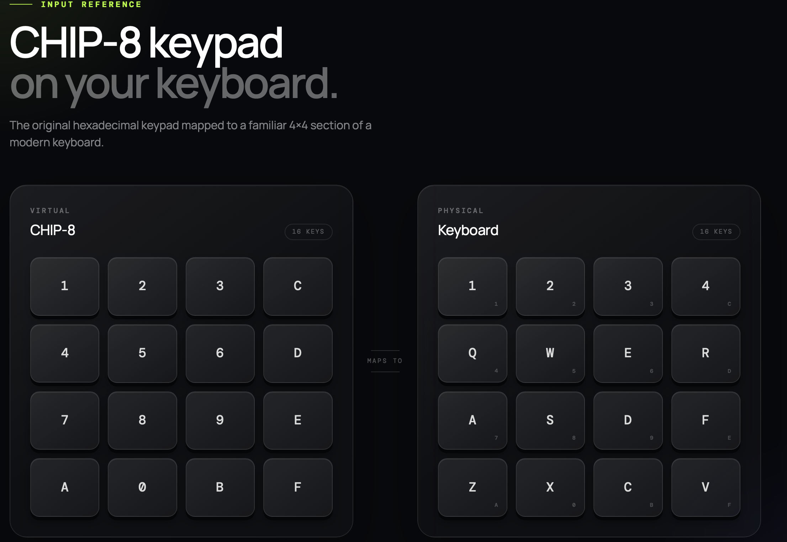
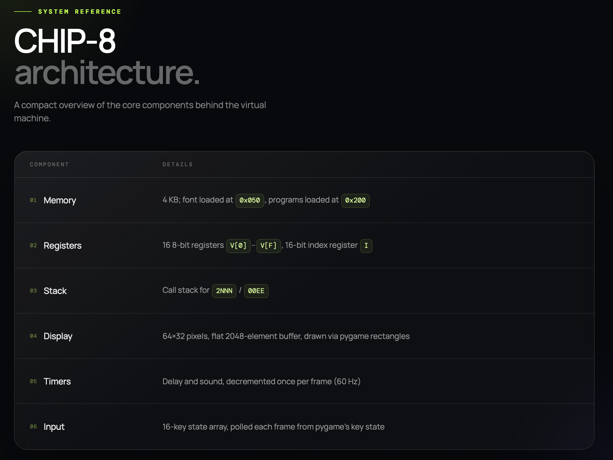
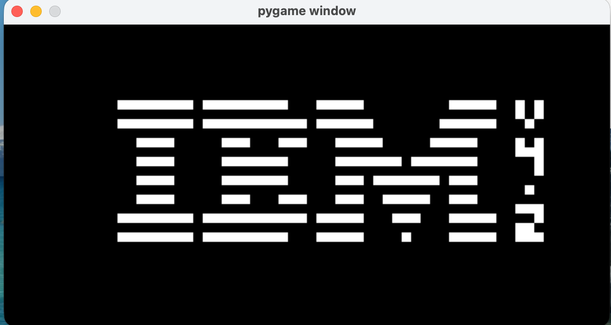

# CHIP-8 Emulator

A CHIP-8 emulator written in Python that uses Pygame to render the display. CHIP-8 is an interpreted programming language used on 8-bit microcomputers such as the COSMAC VIP in the mid-1970s to make game programming easier. This project emulates CHIP-8 so it can run classic ROMs such as Pong, Breakout, Space Invaders, and the IBM logo demo.

## Overview

This repository contains a CHIP-8 interpreter written from scratch. It implements the fetch/decode/execute cycle, standard opcodes, a 64 by 32 display, a 16-key hexadecimal keypad, and delay and sound timers. It is designed to help anyone run classic CHIP-8 games such as Pong or study how a simple emulator works.

## Features

- Full CHIP-8 instruction set, including `0x8XY6`/`0x8XYE` shifts and `0xFX0A` key waits
- 64x32 display rendered at 640x320 (10x scale)
- 16-key hexadecimal keypad mapped to the keyboard
- Delay and sound timers, ticked at 60Hz
- Built-in hexadecimal font set (0-F), loaded into memory from `0x050`
- Easy setup and configuration

## Tech Stack

- Language: Python
- Library: Pygame (for rendering and input)

## Getting Started

### Prerequisites

Make sure you have the following installed:

- Python 3.8+
- Pygame

### Installation

```sh
git clone https://github.com/Lucas30-23/chip8-emulator.git
cd chip8-emulator
pip install pygame
```

### Running the Project

```sh
python "Chip-8 Emulator.py"
```

## Usage

Currently, the emulator loads a ROM using a hardcoded call to `load_ROM()` near the bottom of the script rather than a command-line argument.

To run a different ROM:

1. Place your `.ch8` ROM file in the `roms/` folder.
2. Open `Chip-8 Emulator.py` and edit the `load_ROM(...)` call near the bottom of the file to point to the ROM you want:

   ```python
   load_ROM("roms/YOUR_ROM_FILE.ch8")
   ```

3. Run the emulator:

   ```sh
   python "Chip-8 Emulator.py"
   ```

Several test ROMs and games are referenced in the code (commented out), including the IBM logo, corax+, flags, keypad, quirks, Pong, Space Invaders, and Breakout. Uncomment the ROM you want to run and comment out the others.



## Project Structure

```text
.
├── Chip-8 Emulator.py
├── roms/            # .ch8 ROM files
├── docs/            # screenshots and diagrams (e.g. controls.png)
├── README.md
├── TESTING.md
└── LICENSE
```

## How It Works



### Showing the project working



*Proof of working emulation with IBM logo rendering*

This emulator has also been verified against [Timendus's CHIP-8 Test Suite](https://github.com/Timendus/chip8-test-suite), including opcode-level proof for the keypad instructions. See [TESTING.md](TESTING.md) for the full write-up and GIFs.

## Credits
- **[pygame](https://www.pygame.org/)** — used for rendering the display and handling keyboard input.
- **[Timendus's CHIP-8 Test Suite](https://github.com/Timendus/chip8-test-suite)** — the `2-ibm-logo.ch8`, `3-corax+.ch8`, `4-flags.ch8`, `5-quirks.ch8` and `6-keypad.ch8` ROMs used to verify opcode correctness (GPL-3.0 licensed). The Corax+ test is itself based on an earlier ROM by [corax89](https://github.com/corax89/chip8-test-rom).


## Contributing

Contributions are welcome. To contribute:

1. Fork the repository.
2. Create your feature branch.
3. Commit your changes.
4. Push to the branch.
5. Open a pull request.

## License

This project is licensed under the [MIT License](LICENSE).

## Contact

For questions or support, contact:

- Name: Lucas Bevis
- Email: lucas.bevis@icloud.com
- GitHub: [Lucas30-23](https://github.com/Lucas30-23)

## Roadmap

- [ ] Command-line ROM loading instead of editing the script
- [ ] Sound output (the sound timer is tracked but not played)
- [ ] Adjustable clock speed / instructions-per-frame setting