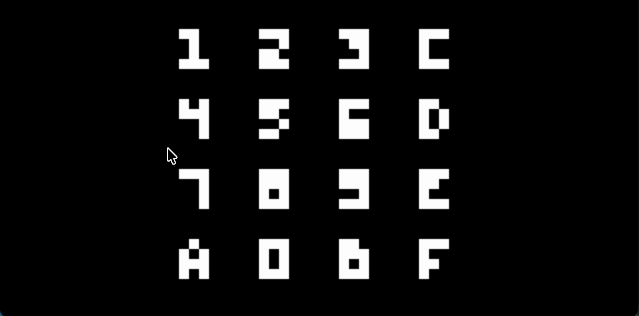
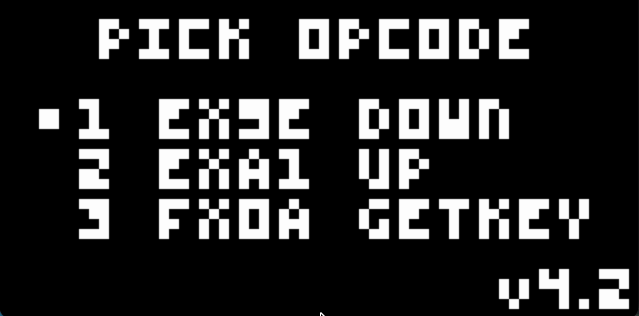
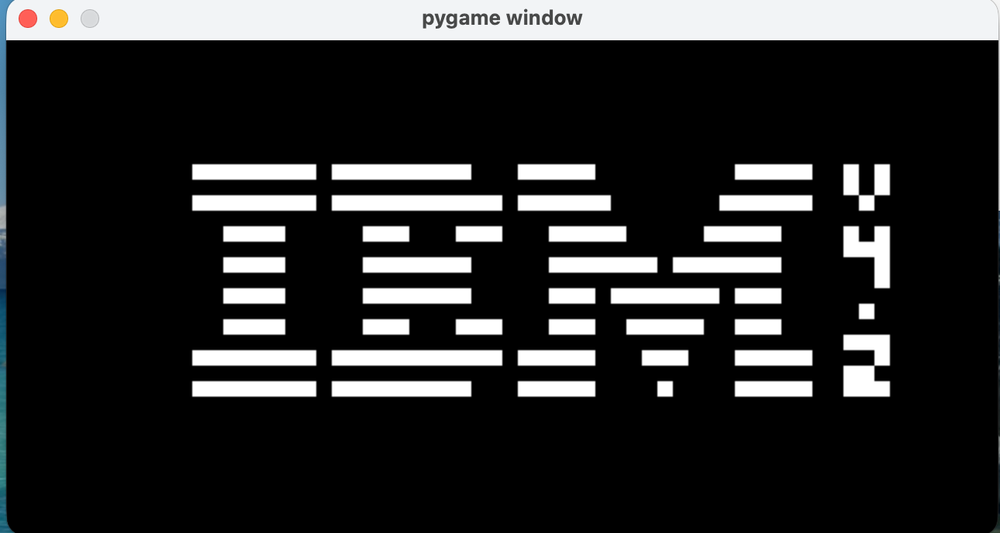
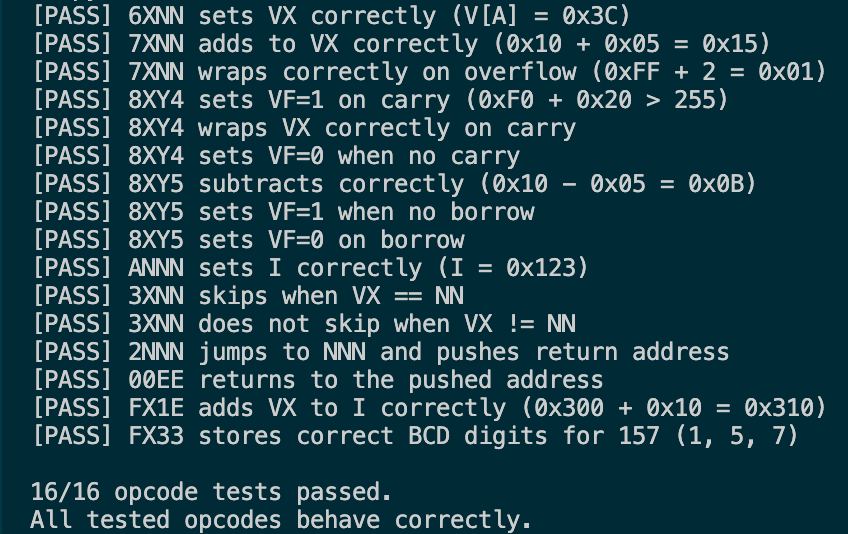
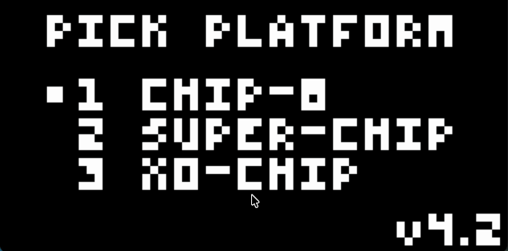

# Testing

This emulator has been verified against [Timendus's CHIP-8 Test Suite](https://github.com/Timendus/chip8-test-suite), which checks opcode correctness, timing quirks, and keypad handling against the CHIP-8 specification. The relevant ROMs (`2-ibm-logo.ch8`, `3-corax+.ch8`, `4-flags.ch8`, `5-quirks.ch8`, `6-keypad.ch8`) are included in the `roms/` folder.

## Console opcode tests

`Test opcodes.py` is a standalone, Pygame-free test script included in this repo. It re-implements the core opcode logic in isolation and checks each one against its expected result, printing a `PASS`/`FAIL` line per test straight to the terminal. Run it with:

```sh
python3 "Test opcodes.py"
```

## Keypad opcode verification (6-keypad.ch8)

The keypad test ROM exercises the three opcodes responsible for reading key input: `EX9E` (skip if key pressed), `EXA1` (skip if key not pressed), and `FX0A` (wait for key press). Below is proof of each working correctly.



*Proof of working `EX9E` opcode using `6-keypad.ch8`*


*Proof of working `EXA1` opcode using `6-keypad.ch8`*



*Proof of working `FX0A` opcode using `6-keypad.ch8`*

## IBM logo (display and drawing opcodes)

The IBM logo ROM is a simple, widely-used first test for display and drawing correctness (`00E0`, `6XNN`, `ANNN`, `DXYN`).



*Proof of working emulation with IBM logo rendering*

## Opcode Test



*Opcode Testing*

## Timendus Test



*Proof of verified CHIP-8 emulator using `5-quirks.ch8`*

## Running the tests yourself

1. Edit the `load_ROM(...)` call in `Chip-8 Emulator.py` to point at one of the test ROMs in `roms/`, e.g.:
   ```python
   load_ROM("roms/6-keypad.ch8")
   ```
2. Run the emulator:
   ```sh
   python "Chip-8 Emulator.py"
   ```
3. Follow the on-screen instructions in the test ROM to step through each check.

See the main [README](README.md) for general setup and usage.